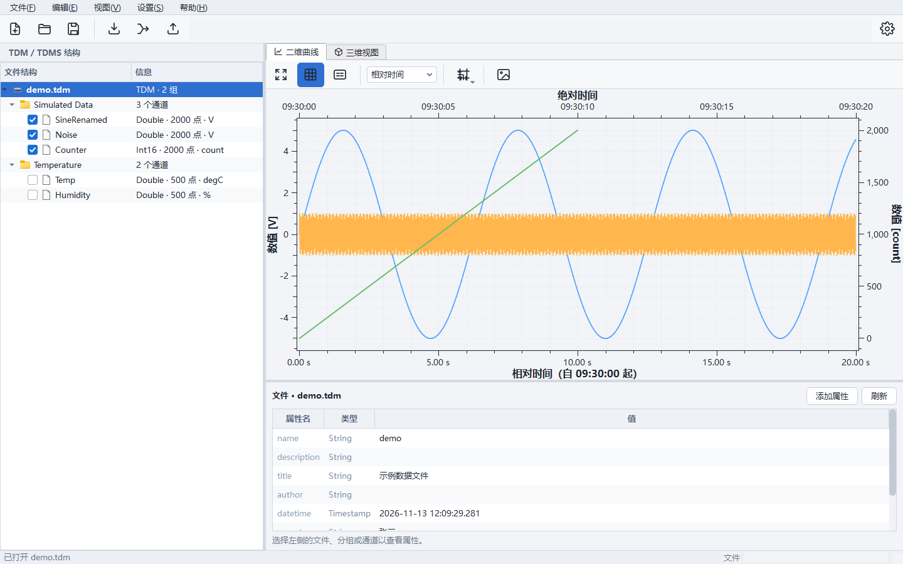
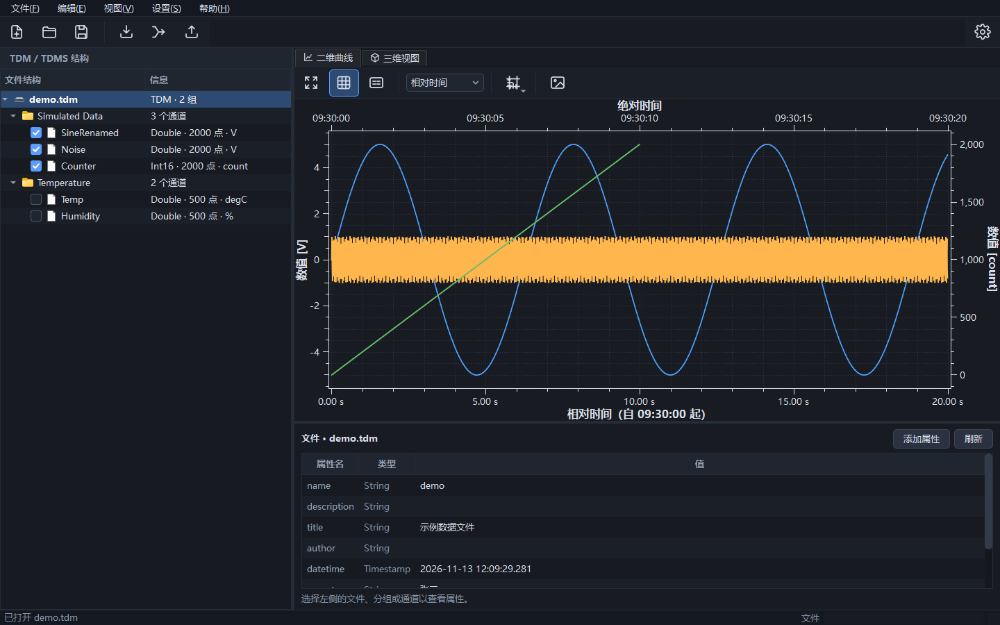
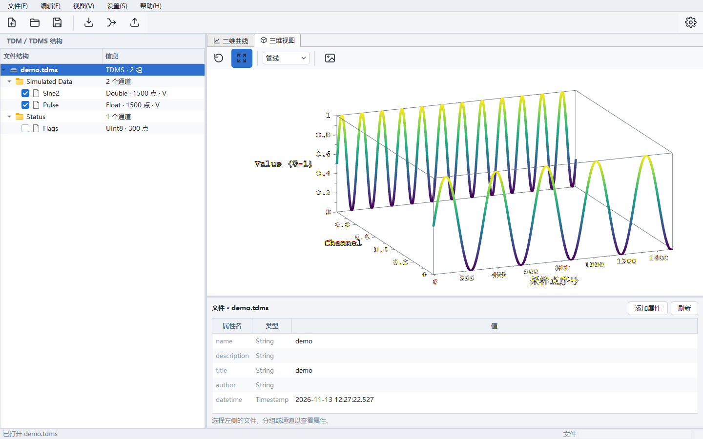

# TDMS Viewer

基于 **C++ / Qt 6 + NI TDM C DLL** 的 TDM / TDMS 文件浏览、编辑与转换工具。二维曲线使用
**Qwt 7**，上下左右四条坐标轴可分别开关；三维视图基于 **qwt::plot3d**，可同时显示多个通道。
主题默认跟随系统，全部首选项保存在本地 INI 文件，**不写注册表**。







## 功能

- 打开、新建、保存、另存为 `.tdm` / `.tdms`；树形显示 文件 → 分组 → 通道三级结构。
- 勾选任意多个通道绘制曲线，按单位自动分配左右 Y 轴；支持缩放、平移、十字光标读数。
- X 轴可选**相对时间 / 绝对时间 / 采样点序号**；四条坐标轴可分别显示或隐藏。
- 三维视图按通道显示空间曲线，可旋转、缩放、平移，支持管线 / 细线 / 散点样式与幅值归一化。
- 查看与修改文件 / 分组 / 通道三级属性，可新增自定义属性。
- 导入 TXT / CSV，导出 TXT / CSV（单通道 / 分组 / 整文件），合并两个 TDM / TDMS 文件。
- 浅色 / 深色 / 跟随系统主题，矢量图标随主题着色；`设置 → 首选项` 集中配置。

## 安装

### 二进制包（Windows x64，免安装）

解压 `TdmsViewer-<版本>-win64.zip` 到任意目录，直接运行 `TdmsViewer.exe`。

- 需要 **Microsoft Visual C++ 2015 (VC140) 或更高运行库**（NI 库依赖，请通过微软官方安装包安装）。
- 三维视图需要显卡驱动支持 **OpenGL 3.3 Core**；不满足时二维视图不受影响。
- 首次运行会在程序目录生成 `config/TdmsViewer.ini`。
- `licenses/` 存放全部第三方许可文本与归属声明；其中的 **NI 运行时 DLL 不得再分发**。

### 从源码构建

依赖：Qt 6.11.2 `msvc2022_64`、MSVC 2022 (x64)、CMake ≥ 3.20、Ninja、NI TDM C DLL 17.0 SDK；
Qwt 7.5.2 源码已随仓库提供（含三维折线的本地修正，见 `patches/`）。

```bat
build.bat                 :: Release，产物为 build\TdmsViewer.exe
build.bat Debug           :: Debug（Qwt 侧需先运行 tools\build_qwt.bat Debug）
```

首次构建会自动编译安装 Qwt 7、复制 NI 与 Qwt 运行时、执行 `windeployqt` 部署 Qt 依赖。
仅重新编译 Qwt 可用 `tools\build_qwt.bat [Release|Debug] [rebuild]`。

**源码包不含 NI TDM C DLL SDK**：其许可不允许把 SDK 作为独立内容提供给第三方，
请自行从 NI 获取 17.0 SDK 并指定位置（也可直接用 `-DTDM_ROOT=<path>` 传给 CMake）：

```bat
set TDM_ROOT=D:\sdk\TDM C DLL
build.bat
```

| 环境变量 | 用途 | 默认值 |
| --- | --- | --- |
| `QT_DIR` | Qt 安装前缀 | `C:\Qt\6.11.2\msvc2022_64` |
| `TDM_ROOT` | NI TDM C DLL SDK 根目录 | 仓库内 `TDM C DLL/` |
| `CMAKE_EXE` / `NINJA_EXE` | CMake / Ninja 可执行文件 | Qt 附带版本，找不到时回退 `PATH` |

手工构建可先 `call tools\env.bat` 配置 MSVC 环境，再用 CMake 配置与编译；
`QWT_ROOT` 默认指向 `third_party/qwt-install`。

## 使用

1. **打开文件**：`文件 → 打开文件` 选择 `.tdm` / `.tdms`；在左侧树勾选通道加入曲线，
   不同单位会自动使用右侧 Y 轴。
2. **属性**：选中文件、分组或通道，下方属性表双击「值」修改，或用 `添加属性` 新增；
   修改先写入内存，`Ctrl+S` 保存后落盘。
3. **时间轴与坐标轴**：绘图工具栏的 `X 轴` 切换时间显示方式，`坐标轴 ▾` 分别开关四条轴；
   默认值在首选项中设置。
4. **三维视图**：切换到 `三维视图` 标签页，左键拖动旋转、滚轮缩放、`Ctrl`+拖动平移，
   `重置视角` 返回默认视角。
5. **导入 / 导出 / 合并**：均在 `文件` 菜单，按对话框选择范围、格式与合并模式。
6. **首选项**：`设置 → 首选项`（`Ctrl+,`）配置主题、时间轴、四轴、三维样式与导出默认值；
   `设置 → 主题` 可快速切换。

`samples/` 中的 `demo.tdm`、`demo.tdms` 与 `import_demo.csv` 可直接用于试用。

## 配置

首选项**只写入本地 INI 文件**，不触碰注册表。路径按以下顺序确定：

1. 环境变量 `TDMSVIEWER_CONFIG` 指定的文件（便于多套配置或便携使用）；
2. `<程序目录>\config\TdmsViewer.ini`（默认）；
3. 程序目录不可写时，落到 `%APPDATA%\TdmsViewer\TdmsViewer.ini`。

首选项「数据与导出」页会显示当前实际路径。INI 是普通文本，可手工编辑，例如：

```ini
[axes]
bottom=true
top=true
left=true
right=false
topMode=2          ; 0=与下轴相同 1=相对时间 2=绝对时间 3=采样点序号

[plot3d]
enabled=true
style=0            ; 0=管线 1=细线 2=散点
normalize=true
```

命令行覆盖项仅对本次运行生效，不会写入已保存的配置：
`--theme light|dark|system`、`--axis relative|absolute|sample`、`--tab curve|3d`。

## 已知限制

- 同时只打开一个文件；无撤销 / 重做。
- SDK 不提供删除属性的接口，属性只能新增与修改；TDMS 下删除分组 / 通道会重写整个文件。
- 字符串与时间戳通道可浏览、导出，但不参与曲线绘制。
- 时间轴依赖 `wf_start_time` / `wf_increment` 等波形属性；缺失且未开启「按 1 s 估算」时
  只能退回采样点序号。
- 三维视图每条通道最多取 4000 点，散点样式为避免点重叠成实线会进一步抽稀到约 450 点。
- 三维中文轴标题有轻微双影，属上游字体渲染的遗留现象。

## 许可

本项目原创代码采用 **Apache License 2.0**，全文见 [`LICENSE`](LICENSE)，归属声明见
[`NOTICE`](NOTICE)。

NI TDM C DLL、Qwt、QwtPlot3D、Qt、USI / Xerces 等第三方组件由各自权利人单独授权，
**不在 Apache-2.0 授权范围内**。其中 NI TDM C DLL 受
`licenses/NI-TDM-DLL-license.rtf`（二进制包内）约束，使用者不得再分发。
完整条款与版权声明见 [`THIRD_PARTY_NOTICES.md`](THIRD_PARTY_NOTICES.md)。
